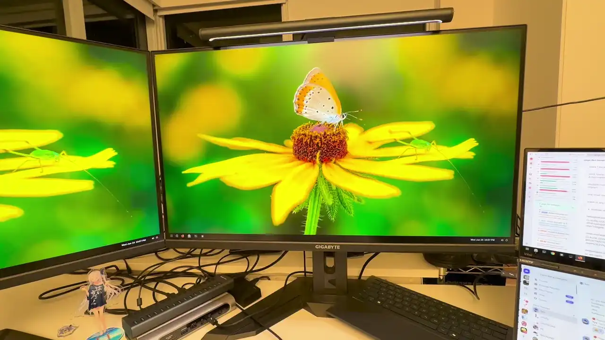
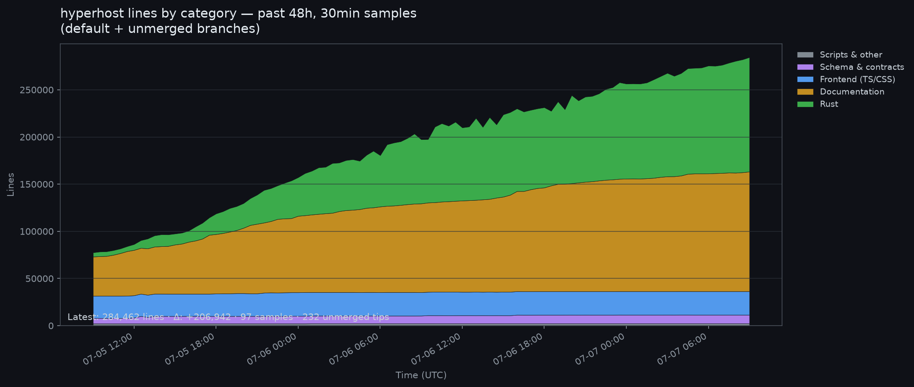

# RMNG

> Infrastructure for every 10x engineer.



## What problem does it solve?

Running one agent to develop software is easy. Running a dozen of them is painful:

You need a **separate sandbox** for each agent. RMNG gives each agent a full GNOME desktop, gpu acceleration, seperate network namespace, and seperate filesystem. Agents run real services side by side and never step on each other.

You need to **see and steer** each agent. A coding agent designing a web app or driving a GUI app is invisible from a terminal, and a laggy remote desktop makes supervising several of them miserable. RMNG's viewer runs in Chrome with hardware decode, runs at 60fps on LAN, and switches between clones instantly.

You need to **pack** a lot of agents onto one machine. RMNG's custom GPU accelerated remote desktop stack with a patched GNOME encodes only the clone you are watching, and lets you fit far more of them on the same hardware.

You need to **efficiently multi-task** with the fleet. RMNG watchs every desktop for you, and flags the exact clone that needs you your attention. An `rmng` CLI and a web dashboard drive the whole fleet, and automated Claude/Codex account rotation keeps agents working instead of stalling on limits.

## How does it solve it?

A remote-desktop stack written from scratch is the core of RMNG. It collects frames from every clone, encodes the selected clone's frames, and sends them to a browser viewer with multi-monitor support. The pipeline is zero-copy, GPU-accelerated H.264, and hits 60fps on LAN. See the [Features](#features) section for the full list.

## How does it compare?

RMNG sits in the gap between desktop infrastructure and agent orchestration: real GPU desktops, local control, and a fast operator console.

| Capability                                                                  | RMNG | Terminal agent orchestrators (Conductor, Async) | IDE background agents (Cursor, Copilot) | Devin / Cognition | Agent desktop infra (Scrapybara, Bytebot) | Cloud desktop / VDI (Kasm) |
| --------------------------------------------------------------------------- | ---- | ----------------------------------------------- | --------------------------------------- | ----------------- | ----------------------------------------- | -------------------------- |
| Full GPU Linux desktop per agent                                            | ✅    | ❌ terminal/git only                             | ❌ inside the editor                     | ⚠️ opaque cloud VM | ✅                                         | ✅                          |
| One human oversees many agents at once                                      | ✅    | ⚠️ text panes                                    | ❌ one at a time                         | ❌ per-task        | ❌ infra, not oversight                    | ❌                          |
| Hardware-accelerated viewer (60fps, multi-monitor, instant takeover)        | ✅    | ❌                                               | ❌                                       | ❌                 | ⚠️ WebRTC                                  | ⚠️ WebRTC                   |
| Self hosted                                                                 | ✅    | ✅                                               | ❌ cloud                                 | ❌ cloud           | ❌ mostly hosted                           | ✅                          |
| Built for AI agents from the ground up                                      | ✅    | ✅                                               | ✅                                       | ✅                 | ✅                                         | ❌ VDI heritage             |

## Does it work?

RMNG builds Hyperhost, an unreleased cloud provider infrastructure product. One Fable 5 agent controls 20 agents running in RMNG clones, producing more than 100k lines of code per day.



## Features

**Remote Desktop**

- Zero-copy hardware H.264 pipeline (VA-API encode on the server)
- Browser viewer in Chrome: H.264 over a WebSocket, decoded with WebCodecs
- One browser window per monitor. You move and size each window yourself. Each window has a Fullscreen button at the top left. In fullscreen it shows only when you point at it. Its fullscreen hides Chrome's address bar (macOS fullscreen does not). Keys in a viewer window: F11 fullscreen, Ctrl+Alt+G lock the pointer, Ctrl+Alt+P release it.
- 60fps on local network
- Multi-monitor
- Instant swap between clones
- Absolute and relative pointer
- Rich clipboard bridge, remote↔remote and local↔remote
- Drop a file on a viewer window to upload it to the clone's home folder
- Terminal view for clones with no desktop
- Port forwarding: the dashboard gives an `ssh` command that forwards a local port to a clone port through the bastion

**Fleet Management**

- One control-server Docker container is the web/API/media entrypoint
- Web dashboard with per-clone notes
- Docker + lxcfs clone isolation
- Full GNOME in each clone
- Central SMB share for clone file systems
- Shared folder every clone sees, bound at `/shared` with `~/shared` as a symlink into it
- SSH bastion for clone access

**Agent Native**

- `rmng` fleet management CLI in every clone
- `rmng desktop` can target any clone for computer use
- Computer use MCP inside each clone
- Per-clone assistant chat in the web UI, backed by an outside pi-web server that drives the clone through `rmng`
- Passive per-clone new-token accounting and server-owned activity lifecycle

**Accounts & integrations**

- Import Claude and ChatGPT accounts once and use in all the clones
- 5h + 7d usage visualizer for all accounts
- Live account hot-swap on a running clone, no restart needed
- Named account groups with sticky auto-rotation

## Scope rules

RMNG is a single-operator tool. One person runs it, on their own hardware, reachable only
over Tailscale. Build for that, and nothing else.

**There is no threat model.** The control-server has no authentication on any route, on
purpose. Every caller that can reach the port is the owner. Do not add allowlists, origin
checks, sandboxing headers, content-type policing, or rate limits, and do not harden a route
because a caller "could" abuse it. The caller is you. A reviewer who reports a
request-forgery or cross-site-scripting path on this port has found a fact about the design,
not a defect.

**Trust the client.** The browser and the `rmng` CLI hold the same secrets the server does,
including Linear API keys. When a client sends resolved data, store it. Do not re-derive it,
re-validate it, or defend against a client that lies.

**Write the version with no defensive layer.** Timeouts and size caps are fine when they stop
the server hanging or dying. They are not fine as a security control. If a guard's only
justification is an attacker, delete it.

The failure mode this prevents is real and has happened here: a route grew a host allowlist,
a redirect policy, a closed MIME table, per-field body caps, and 46 hostile-URL tests, none
of which protected against anyone who was not already the owner. Simpler is correct.

## Quick start

> **Hardware support:** the encode path (control-server, VA-API H.264) has only been tested on an AMD Radeon Pro W6800. Other GPUs may work but are untested. The viewer needs Chrome.

Needs a Linux host with Docker, a GPU render node (`/dev/dri/renderD128`), and a ZFS dataset mounted at `/srv/rmng-homes` to hold the clone homes (one child dataset per clone). Pull the published image (or `docker build -t rmng:latest .` from a checkout), then run the hub:

```sh
docker run -d --name rmng --privileged --init --pid host --restart unless-stopped \
  -v /var/run/docker.sock:/var/run/docker.sock \
  -v rmng-data:/data -v rmng-sock:/srv/rmng-sock \
  -v /srv/rmng-homes:/srv/rmng-homes:shared \
  -p 9000:9000 -p 445:445 -p 2222:2222 pegasis0/rmng
```

Ports: `9000` web UI/API and the browser viewer · `445` SMB, serving both the clone-home share and the shared folder (host `445` must be free) · `2222` SSH bastion (jump into clones). The clone-local desktop MCP remains on internal port `9004`.

Open `http://<host>:9000`. The **first-run setup wizard** walks through the environment checklist, server settings, and setup completion. There is no template download step: a clone's system image is built from its preset's Dockerfile, lazily, the first time a create needs it. Full flow, image build, template publishing, upgrades, and the dev loop: [docs/DEPLOY.md](docs/DEPLOY.md). Running the Docker host on a Proxmox LXC CT: [docs/PROXMOX-LXC.md](docs/PROXMOX-LXC.md).

**The viewer needs HTTPS.** Chrome allows WebCodecs, the async clipboard and Keyboard Lock only on a secure page (HTTPS or `localhost`). `http://<tailscale-ip>:9000` is not enough. Open the dashboard itself over HTTPS, because the viewer windows use the dashboard's address. With Tailscale: on the machine that publishes port 9000, run `tailscale serve --bg 9000` (the tailnet must have HTTPS certificates enabled), then open `https://<machine>.<tailnet>.ts.net/`. If Tailscale runs on a different machine, run `tailscale serve --bg http://<ip>:9000` there. Use the `ts.net` name, not an IP: the certificate is for the name, so `https://<ip>/` fails. Without HTTPS the dashboard works, and the viewer window shows a warning instead of video.
